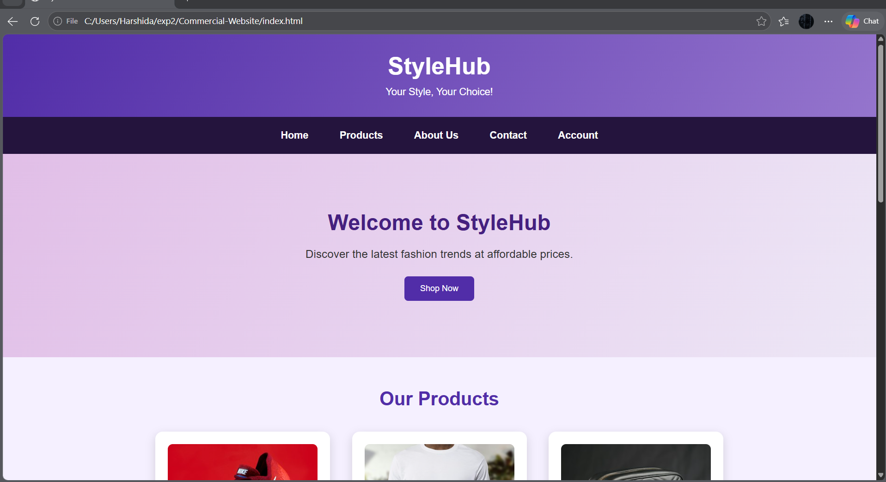
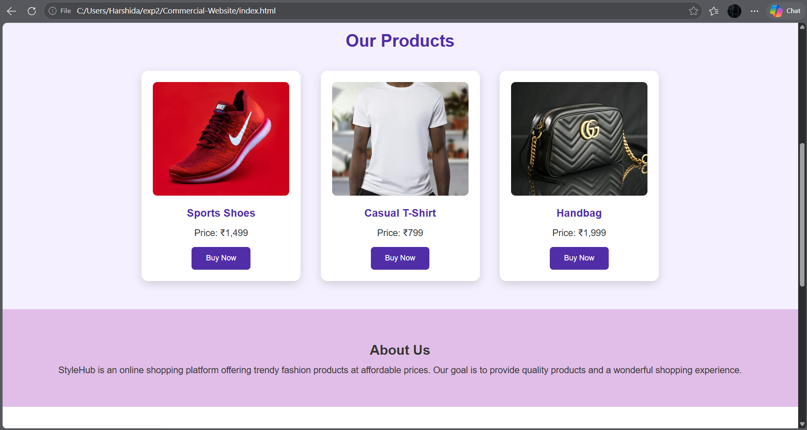
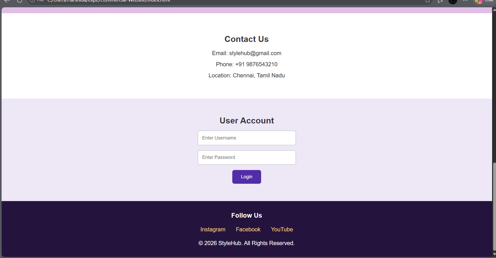

# Ex02 Commercial Website
## Date: 02.11.2026

## AIM
To create a commercial website using CSS Flexbox.

## ALGORITHM
### STEP 1
Create an HTML file (index.html)

### STEP 2
Create a CSS file (style.css)

### STEP 3
Include a navigation bar with links to different sections.

### STEP 4
Add structured sections for Homepage, Products / Services, About Us, Contact Details and User Account.

### STEP 5
Include social media links at the footer with copyright information.

### STEP 6
Define global styles for fonts, colors, and layout.

### STEP 7
Style the header, navigation bar, and sections.

### STEP 8
Use Flexbox for layout design.

### STEP 9
Add hover effects and transitions for interactivity.

### STEP 10
Add Images and Media.

### STEP 11
Use optimized images for a professional look.

### STEP 12
Open the HTML file in a browser to check layout and functionality.

### STEP 13
Fix styling issues and refine content placement.

### STEP 14
Deploy the website.

### STEP 15
Upload to GitHub Pages for free hosting.

## PROGRAM
index.html
```

<!DOCTYPE html>
<html>
<head>
    <title>StyleHub - Commercial Website</title>
    <link rel="stylesheet" href="style.css">
</head>

<body>

    <header>
        <h1>StyleHub</h1>
        <p>Your Style, Your Choice!</p>
    </header>

    <nav>
        <a href="#home">Home</a>
        <a href="#products">Products</a>
        <a href="#about">About Us</a>
        <a href="#contact">Contact</a>
        <a href="#account">Account</a>
    </nav>

    <section class="home" id="home">
        <h2>Welcome to StyleHub</h2>
        <p>Discover the latest fashion trends at affordable prices.</p>
        <button onclick="alert('Welcome to StyleHub!')">Shop Now</button>
    </section>

    <section id="products">
        <h2>Our Products</h2>

        <div class="product-container">

            <div class="product">
                
                <h3>Sports Shoes</h3>
                <p>Price: ₹1,499</p>
                <button onclick="alert('Sports Shoes selected!')">Buy Now</button>
            </div>

            <div class="product">
                
                <h3>Casual T-Shirt</h3>
                <p>Price: ₹799</p>
                <button onclick="alert('T-Shirt selected!')">Buy Now</button>
            </div>

            <div class="product">
                
                <h3>Handbag</h3>
                <p>Price: ₹1,999</p>
                <button onclick="alert('Handbag selected!')">Buy Now</button>
            </div>

        </div>
    </section>

    <section class="about" id="about">
        <h2>About Us</h2>
        <p>
            StyleHub is an online shopping platform offering
            trendy fashion products at affordable prices.
            Our goal is to provide quality products and
            a wonderful shopping experience.
        </p>
    </section>

    <section class="contact" id="contact">
        <h2>Contact Us</h2>
        <p>Email: stylehub@gmail.com</p>
        <p>Phone: +91 9876543210</p>
        <p>Location: Chennai, Tamil Nadu</p>
    </section>

    <section class="account" id="account">
        <h2>User Account</h2>

        <input type="text" placeholder="Enter Username">
        <input type="password" placeholder="Enter Password">

        <button onclick="alert('Login feature is under development!')">
            Login
        </button>
    </section>

    <footer>
        <h3>Follow Us</h3>

        <div class="social">
            <a href="https://www.instagram.com/">Instagram</a>
            <a href="https://www.facebook.com/">Facebook</a>
            <a href="https://www.youtube.com/">YouTube</a>
        </div>

        <p>© 2026 StyleHub. All Rights Reserved.</p>
    </footer>

</body>
</html>
```

Style.css
```

/* Global Styles */
* {
    margin: 0;
    padding: 0;
    box-sizing: border-box;
    font-family: Arial, sans-serif;
}

body {
    background-color: #f5f0ff;
    color: #333;
}

/* Header */
header {
    background: linear-gradient(120deg, #512da8, #9575cd);
    color: white;
    text-align: center;
    padding: 30px;
}

header h1 {
    font-size: 38px;
    margin-bottom: 10px;
}

/* Navigation */
nav {
    display: flex;
    justify-content: center;
    align-items: center;
    gap: 50px;
    background-color: #24143d;
    padding: 20px;
}

nav a {
    color: white;
    text-decoration: none;
    font-weight: bold;
}

nav a:hover {
    color: #ffcc80;
}

/* Home */
.home {
    text-align: center;
    padding: 90px 20px;
    background: linear-gradient(120deg, #e1bee7, #ede7f6);
}

.home h2 {
    font-size: 35px;
    color: #452080;
    margin-bottom: 20px;
}

.home p {
    font-size: 18px;
    margin-bottom: 25px;
}

/* Buttons */
button {
    background-color: #512da8;
    color: white;
    padding: 12px 25px;
    border: none;
    border-radius: 6px;
    cursor: pointer;
}

button:hover {
    background-color: #ff8f00;
}

/* Products */
#products {
    text-align: center;
    padding: 50px 30px;
}

#products h2 {
    color: #512da8;
    font-size: 30px;
    margin-bottom: 35px;
}

.product-container {
    display: flex;
    justify-content: center;
    align-items: stretch;
    flex-wrap: wrap;
    gap: 35px;
}

.product {
    background-color: white;
    width: 280px;
    padding: 20px;
    border-radius: 12px;
    box-shadow: 0 5px 15px rgba(0,0,0,0.15);
    transition: 0.3s;
}

.product:hover {
    transform: translateY(-8px);
}

.product img {
    width: 100%;
    height: 200px;
    object-fit: cover;
    border-radius: 8px;
}

.product h3 {
    color: #512da8;
    margin: 15px 0;
}

.product p {
    margin-bottom: 15px;
}

/* About */
.about {
    background-color: #e1bee7;
    text-align: center;
    padding: 50px;
    line-height: 1.8;
}

/* Contact */
.contact {
    background-color: white;
    text-align: center;
    padding: 50px;
    line-height: 2;
}

/* Account */
.account {
    background-color: #ede7f6;
    text-align: center;
    padding: 50px;
}

.account input {
    display: block;
    width: 280px;
    padding: 12px;
    margin: 15px auto;
    border: 1px solid #aaa;
    border-radius: 5px;
}

/* Footer */
footer {
    background-color: #24143d;
    color: white;
    text-align: center;
    padding: 30px;
}

.social {
    display: flex;
    justify-content: center;
    gap: 30px;
    margin: 20px;
}

.social a {
    color: #ffcc80;
    text-decoration: none;
}

.social a:hover {
    color: white;
}

/* Responsive Design */
@media (max-width: 600px) {
    nav {
        flex-wrap: wrap;
        gap: 20px;
    }

    .product-container {
        flex-direction: column;
        align-items: center;
    }
}
```

## OUTPUT




## RESULT
The program for creating commercial website using CSS Flexbox is executed successfully.
